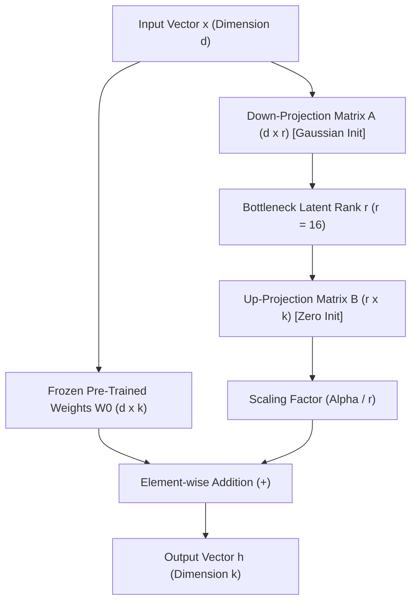
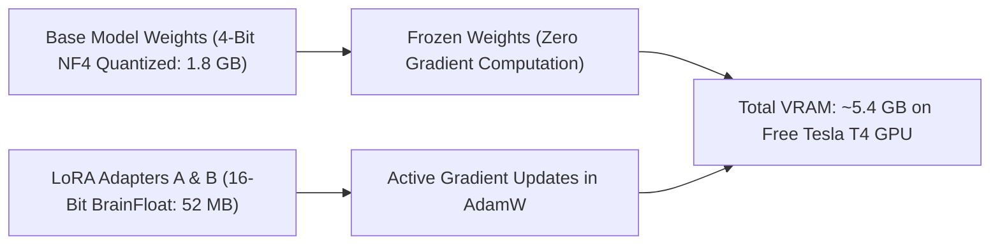

# Parameter-Efficient Fine-Tuning: LoRA & QLoRA Theory

**Client:** Zarya Digital Bank (Pakistan)  
**Task:** Week 10 Capstone — Day 2 Task 3  
**Focus:** Mathematical Foundations, Memory Optimization, and Assistant Token Masking  

---

## 1. Why Full Fine-Tuning Fails on Enterprise Edge Hardware

In standard full fine-tuning of a 3-billion-parameter model, the optimization state requires saving:
* **Model Parameters (FP16 / BF16):** $3\text{B} \times 2\text{ bytes} = 6\text{ GB}$
* **AdamW Optimizer States (FP32 momentum + variance):** $3\text{B} \times 8\text{ bytes} = 24\text{ GB}$
* **Gradients (FP16):** $3\text{B} \times 2\text{ bytes} = 6\text{ GB}$
* **Activations & KV Cache:** $\approx 8\text{ GB}$
* **Total Training VRAM Required:** **$\approx 44\text{ GB}$** (Requires high-end A100/H100 enterprise hardware)

For a self-hosted regional bank, paying for an A100 cluster simply to adapt tone and terminology is economically wasteful. Parameter-Efficient Fine-Tuning (PEFT) solves this by freezing the base model and training only low-rank decomposed adapter matrices.

---

## 2. Low-Rank Adaptation (LoRA) Formulation

LoRA (Hu et al., 2021) hypothesizes that weight updates during domain adaptation have a low "intrinsic dimension".

Instead of updating the full weight matrix $W_0 \in \mathbb{R}^{d \times k}$, LoRA decomposes the weight update $\Delta W$ into two low-rank matrices $B \in \mathbb{R}^{d \times r}$ and $A \in \mathbb{R}^{r \times k}$, where rank $r \ll \min(d, k)$:

$$\Delta W = B \cdot A$$

During the forward pass, the adapted layer computes:

$$h = W_0 x + \Delta W x = W_0 x + \frac{\alpha}{r} (B A) x$$



### Key Parameters:
1. **Rank ($r = 16$):** The inner dimensionality of the adapter. $r=16$ provides enough expressive capacity for banking concepts and UrduLish syntax while keeping trainable parameters below **0.42%** of total weights.
2. **Scaling Factor ($\alpha = 32$):** Scales adapter updates relative to base weights ($\frac{\alpha}{r} = \frac{32}{16} = 2.0$).
3. **Initialization:** Matrix $A$ is initialized from a random Gaussian distribution $\mathcal{N}(0, \sigma^2)$, while matrix $B$ is initialized to zero. At iteration $t=0$, $\Delta W = 0$, guaranteeing that model output is completely identical to the base pre-trained model before training begins.

### Target Modules in Qwen 2.5:
We apply LoRA adapters to all attention and feed-forward linear layers:
* Attention projections: `q_proj`, `k_proj`, `v_proj`, `o_proj`
* MLP projections: `gate_proj`, `up_proj`, `down_proj`

---

## 3. QLoRA: 4-Bit Base Quantization + FP16 Adapters

QLoRA (Dettmers et al., 2023) pushes memory efficiency further through three innovations:

1. **4-Bit NormalFloat (NF4):** An information-theoretically optimal quantile quantization data type that distributes zero-mean, unit-variance pre-trained weights into 16 bins without precision collapse.
2. **Double Quantization (DQ):** Quantizes the quantization constants themselves, saving an additional 0.37 bits per parameter ($\approx 300\text{ MB}$ of VRAM).
3. **Paged Optimizers:** Uses CUDA Unified Memory to automatically page optimizer memory spikes to CPU RAM during long sequence gradient spikes, preventing Out-Of-Memory (OOM) crashes.



---

## 4. Chat Templates & Loss Masking on Assistant Tokens

A major flaw in naive fine-tuning is computing language modeling cross-entropy loss over the user's prompt tokens:

```
[System Prompt] + [User Query] + [Assistant Response]
```

If loss is calculated over the entire sequence:
1. The model wastes optimization capacity learning to predict user typos and random customer phrasing.
2. The model suffers from format degradation and prompt repetition.

### Solution: Assistant Token Masking (`DataCollatorForCompletionOnlyLM`)
In ChatML / Qwen templates:
```
<|im_start|>system\nYou are Zarya Bank's assistant...<|im_end|>
<|im_start|>user\nMera transfer kat gaya...<|im_end|>
<|im_start|>assistant\n[LOSS COMPUTED ONLY FROM HERE] Ji pareshan na hon...<|im_end|>
```

All tokens prior to the `<|im_start|>assistant\n` response delimiter have their labels set to `-100` (PyTorch `ignore_index`). As a result, cross-entropy loss is computed exclusively on the model's empathetic, compliant UrduLish responses.

