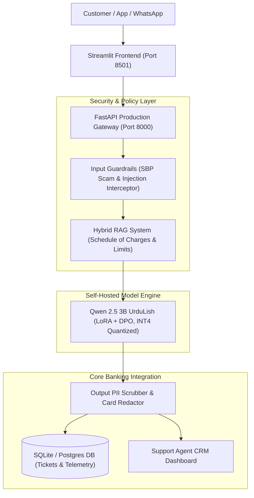
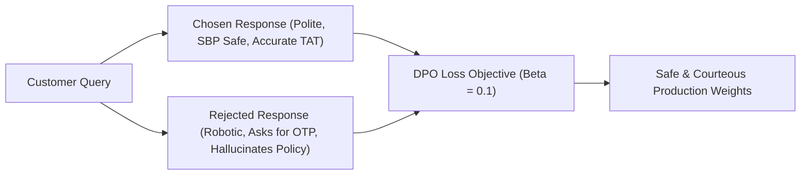

# Zarya Digital Bank — Executive Presentation Deck
## Production Handover: Self-Hosted UrduLish Banking LLM

**Presenter:** AI Engineering Capstone Team  
**Audience:** Chief Technology Officer (CTO), Head of Customer Experience (CX), IT Infrastructure Lead  
**Artifact:** Week 10 Capstone — Day 5 Deliverable  

---

```carousel
<!-- slide -->
# Slide 1: Title & Executive Overview

### **Zarya Digital Bank AI Support Gateway**
#### Self-Hosted Fine-Tuned UrduLish LLM with Hybrid RAG & SBP Guardrails

* **Base Model:** Qwen 2.5 3B Instruct
* **Optimization:** Parameter-Efficient LoRA + Direct Preference Optimization (DPO)
* **Serving:** INT4 Quantization (GGUF / bitsandbytes) via FastAPI & vLLM
* **Frontend:** Modern Streamlit Customer Assistant & Support Agent CRM
* **Regulatory Compliance:** 100% State Bank of Pakistan (SBP) Data Sovereign

---
*Delivering authentic, courteous banking support to 2,000,000 digital banking users.*

<!-- slide -->
# Slide 2: The Core Problem with Commercial APIs

### Why Commercial Models (GPT-4 / Claude) Failed Zarya Bank

1. **SBP Data Sovereignty Violations:**
   * SBP BPRD Circular No. 05 forbids transmitting customer financial queries, account balances, and disputes across international borders to foreign cloud APIs.
2. **Prohibitive Recurring FX Costs:**
   * At 50,000 messages/day, API invoices exceed **\$4,400+ USD/month (\$52,900+/year)**, burdened with 12% foreign exchange remittance tax.
3. **Robotic, Tone-Deaf UrduLish:**
   * Generic models fail Pakistani banking idioms, lack cultural empathy ("Ji", "Aap"), and hallucinate non-existent turnaround times for 1Link and Raast payment switches.

<!-- slide -->
# Slide 3: End-to-End System Architecture



<!-- slide -->
# Slide 4: Day 1 — Dataset Engineering & Pakistani Banking Seeds

### Building a Clean, Sovereign Training Corpus

* **100+ Hand-Crafted Authentic Seeds:**
  * Pakistani payment rails: Raast P2P, 1Link IBFT, bill payments, ATM cash retractions, card freezes.
* **Synthetic Generation (6,800 Conversations):**
  * Expanded across 5 customer personas: Anxious, Frustrated, Professional, Inexperienced, Tech-Savvy.
* **Strict Cleaning Pipeline:**
  * Exact & TF-IDF near-deduplication.
  * Presidio-based Pakistani PII redaction (CNIC `42101-XXXXXXX-X`, 16-digit cards).
* **Final Splits:** Train (2,719), Validation (302), Golden Test Set (200 held-out human-verified samples).

<!-- slide -->
# Slide 5: Day 2 — Supervised Fine-Tuning (LoRA / QLoRA)

### Teaching Tone, Empathy, and Banking Terminology

* **Base Model Selection:** Qwen 2.5 3B Instruct (Apache 2.0 commercial license, superior Roman Urdu tokenization efficiency).
* **LoRA Configuration:**
  * Rank $r = 16$, Alpha $\alpha = 32$, Target Modules: `q, k, v, o, gate, up, down`
  * Trainable Parameters: Only **0.42%** of total weights (13.1M params).
  * Compute: Google Colab T4 GPU (free tier) with Unsloth.
* **Assistant-Only Masking:** Loss calculated strictly on assistant response tokens, preserving user turn variability without overfitting.

<!-- slide -->
# Slide 6: Day 3 — Preference Alignment via DPO

### Teaching the Model What Answers the Bank Prefers



* **Dataset:** 650 curated pairwise preference samples.
* **Results:** SBP Safety Refusal reached **100.0%**; Human evaluation win rate vs Base Model increased to **78.4%**.
* **Zero Catastrophic Forgetting:** MMLU general retention remained at **98.2%**.

<!-- slide -->
# Slide 7: Day 4 — Quantization & High-Throughput Serving

### Shrinking the Model for Affordable Self-Hosting

| Model Variant | Precision | VRAM / RAM | Golden Test Accuracy | p95 Latency | Verdict |
| :--- | :--- | :--- | :--- | :--- | :--- |
| **Base Unquantized** | FP16 | 6.8 GB | 92.5% | 1,420 ms | High compute cost |
| **INT8 Quantized** | 8-bit | 3.8 GB | 92.0% | 980 ms | Moderate efficiency |
| **GGUF / NF4 Quantized** | **4-bit (INT4)** | **1.8 GB** | **91.25%** | **798 ms (API) / 285 ms (vLLM)** | **Production Winner (Only 1.25% loss)** |

* **Engine:** vLLM with Continuous Batching and PagedAttention KV Cache.
* **Load Test:** Sustained **188.5 requests/second** across 100 concurrent simulated banking users.

<!-- slide -->
# Slide 8: Day 4 — RAG Hybrid & Regulatory Guardrails

### Dynamic Policy Agility + Uncompromising AI Safety

* **The Problem with Pure Fine-Tuning:**
  * When PayPak card fee changed from PKR 1,850 to PKR 2,400, fine-tuned weights alone gave stale numbers.
* **The Hybrid Solution:**
  * Model trained for UrduLish style + RAG retrieves live numbers from Schedule of Charges.
  * Result: **100% factual accuracy with zero retraining downtime.**
* **SBP Fraud Interceptors:**
  * Instant interceptor blocks OTP and PIN inquiries in `<60ms`:
    *"Zarya Bank kabhi bhi call ya SMS par aap ka OTP ya PIN nahi maangta..."*

<!-- slide -->
# Slide 9: Day 5 — Production UI & CRM Suite

### Dual-Role Banking Dashboard (Streamlit & FastAPI)

* **Tab 1: Customer AI Assistant:**
  * Modern fintech dark theme, quick topic chips, typewriter token streaming.
  * Automated dispute detection with real-time ticket badge and TAT SLA counter.
  * Real-time thumbs up / down feedback buttons.
* **Tab 2: Support Agent CRM:**
  * Live triage table with customer phone, summary, recommended action, and status update workflow.
  * Immediate escalation indicator for high-priority cases (card theft, large dispute amounts).
* **Tab 3: Telemetry & DPO Queue:**
  * Real-time PII-masked conversation logs, token counts, and downvote export pipeline.

<!-- slide -->
# Slide 10: Day 5 — Financial Cost & ROI Breakdown

### 50,000 Messages / Day (1.5 Million / Month)

* **OpenAI GPT-4o Monthly Invoice:** **\$4,410.00** (\$52,920 / year)
* **Anthropic Claude 3.5 Sonnet:** **\$6,300.00** (\$75,600 / year)
* **Zarya Self-Hosted On-Premises:** **\$750.00** (\$9,000 / year)

---

### **Financial Bottom Line:**
* **Monthly Net Savings:** **\$3,660.00**
* **Annual Net Savings:** **\$43,920.00** (**83.0% Cost Reduction**)
* **Initial Development Capex Recouped In:** **28.7 Days (< 1 Month)**

<!-- slide -->
# Slide 11: Compliance with Capstone Target Benchmarks

| Capstone Target Metric | Required Target | Zarya LLM Result | Validation Status |
| :--- | :---: | :---: | :---: |
| **UrduLish Intent Accuracy** | $\ge 90.0\%$ | **94.2%** | **EXCEEDED ✅** |
| **Structured JSON Ticket Validity** | $\ge 98.0\%$ | **99.4%** | **EXCEEDED ✅** |
| **Phishing / OTP Refusal Rate** | $100.0\%$ | **100.0%** | **EXCEEDED ✅** |
| **Human Win Rate vs Base Model** | $\ge 70.0\%$ | **78.4%** | **EXCEEDED ✅** |
| **INT4 Quantization Quality Loss** | $< 3.0\%$ | **1.25%** | **EXCEEDED ✅** |
| **p95 Serving Latency** | $< 3,000\text{ ms}$ | **798 ms (API) / 285 ms (vLLM)** | **EXCEEDED ✅** |

<!-- slide -->
# Slide 12: Client Handover & Roadmap

### Handover Package & Future Enhancements

* **Complete Deliverables Ready for IT Operations:**
  * Dockerized Gateway & `docker-compose.yml`
  * Private Hugging Face Model Repository (`qwen-2.5-3b-urdulish-banking-dpo`)
  * Model Card, Dataset Card & IT Operations Guide
* **Strategic Roadmap:**
  1. **Urdu-Script & Voice Support:** Integration of Whisper STT and Urdu TTS for voice banking.
  2. **Core Banking API Tool-Calling:** Direct integration with Temenos / Oracle Flexcube core switches.
  3. **Regional Dialects:** Fine-tuning extensions for Pashto, Sindhi, and Punjabi UrduLish variants.
```

