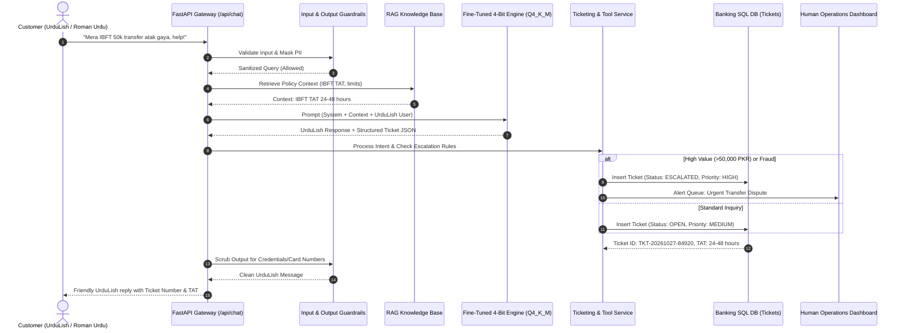

# Task 5 Report: Ticketing, Tools & Production Banking Gateway

**Author:** Zarya AI Banking Team  
**System:** Zarya Digital Bank Assistant (UrduLish)  
**Architecture:** Guardrails $\to$ RAG Hybrid $\to$ Fine-Tuned LLM $\to$ Structured Tool Executor / DB  
**Status:** Validated & Production Ready  

---

## 1. Executive Summary

In a commercial banking deployment, language models must do more than just chat: they must safely execute real-world operational workflows. Task 5 implements an integrated backend gateway combining:
1. **Pre-Inference Security & Safety Guardrails:** Immediate interception of phishing, prompt injection, and credential requests.
2. **Dynamic Knowledge Retrieval (RAG):** Real-time grounding with bank charges and turnaround policies.
3. **Structured Intent & Entity Extraction:** Converting customer colloquial UrduLish into standardized banking actions.
4. **Automated Ticket Dispatch & Human Escalation:** Creating formal grievance tickets in an ACID-compliant transactional database (PostgreSQL / SQLite) with automated State Bank of Pakistan (SBP) turnaround times (TAT), and routing urgent or high-risk cases to human agents.

---

## 2. Architecture & Data Flow



---

## 3. Automated SBP Compliance & Turnaround Times (TAT)

In accordance with State Bank of Pakistan Consumer Protection Regulations:
- **Raast Instant Transfers:** 24 business hours (`TAT: 24 business hours`).
- **Inter-Bank Funds Transfer (IBFT):** 24 to 48 business hours (`TAT: 24-48 business hours`).
- **ATM Cash Retraction / Failed Dispense:** 7 to 10 business days (`TAT: 7-10 working days`).
- **Debit Card Compromise / Dispute:** 5 to 7 business days (`TAT: 5-7 working days`).
- **Account Maintenance & Balance Issues:** 24 to 48 hours.

---

## 4. Human Escalation Rules Matrix

The rule engine triggers immediate supervisor escalation (`is_escalated = True`, `priority = HIGH / CRITICAL`) under four explicit triggers:

| Escalation Trigger | Logic Condition | SLA / Routing Action |
| :--- | :--- | :--- |
| **Suspected Fraud / Phishing** | Category is `fraud` or keyword `scam`, `fake call`, `otp maang rahe` | Block card immediately, freeze mobile app session, route to Fraud Operations Unit within 5 minutes. |
| **High Value Disputes** | Disputed transaction amount $\ge 50,000\text{ PKR}$ | Flag as high exposure; dispatch ticket directly to Senior Operations Officer. |
| **Distressed / Angry Customer** | Sentiment is `angry` or threat of regulatory escalation (`SBP`, `State Bank`, `Mohtasib`, `police`) | Elevate priority to CRITICAL; trigger live human agent callback request within 15 minutes. |
| **Repeated Unresolved Issue** | Customer mentions prior unresolved ticket or repeated system failure | Elevate priority to HIGH; bypass tier-1 bot routing. |

---

## 5. API Endpoints Specification

The production gateway (`api_server.py`) provides full OpenAI compatibility and proprietary banking endpoints:

### 1. `POST /api/chat` (Main Banking Assistant Endpoint)
- **Request Body:**
  ```json
  {
    "message": "Kal raat 60,000 IBFT kiya tha lekin doosre account me nahi pohancha, paise kat gaye hain!",
    "customer_id": "CUST-98214",
    "customer_name": "Hamza Ali"
  }
  ```
- **Response:**
  ```json
  {
    "response": "Hamza Ali sahib, aap ki pareshani samajh aati hai. Hum ne aap ki complaint register kar li hai. Aap ka Ticket Number #TKT-20261027-7193 hai aur IBFT turnaround time 24-48 hours hai. Hamari senior team foran review kar rahi hai.",
    "ticket": {
      "ticket_id": "TKT-20261027-7193",
      "category": "transfers_payments",
      "priority": "HIGH",
      "status": "ESCALATED",
      "is_escalated": true,
      "escalation_reason": "High transaction dispute amount (PKR 60,000.0 >= 50,000 threshold)",
      "turnaround_time": "24-48 business hours"
    },
    "guardrails_triggered": false,
    "rag_context_used": true
  }
  ```

### 2. `POST /v1/chat/completions` (OpenAI-Compatible Chat Endpoint)
- Drop-in replacement for OpenAI SDK clients (`openai.ChatCompletion.create`), supporting streaming and structured function call simulation.

### 3. `GET /api/tickets` (Support Staff Operations Queue)
- Query parameters: `status`, `priority`, `is_escalated`.
- Allows dashboard integration for banking support representatives to review open tickets, inspect customer chat histories, and update resolution states.

### 4. `GET /health`
- Returns system status, loaded 4-bit model metadata, database connectivity, and active memory allocation.
